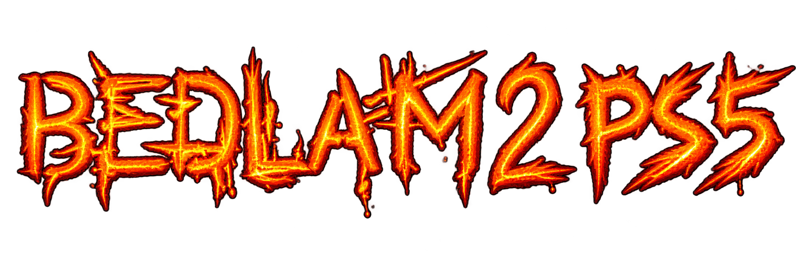

# Bedlam 2: Absolute Bedlam — PS5



An unofficial native PlayStation 5 port of *Bedlam 2: Absolute Bedlam*, based
on the [8street source project](https://github.com/8street/Bedlam2). It runs the
game's engine with an SDL frontend and DualSense support, rather than through
DOSBox. This is a fan project and is not an official release.

## Version 1.0.0-rc.1

The first 1.0 release candidate is available for PS5 testing. The release
contains the native PS5 app package. Original Bedlam 2 game data is not bundled
and must be supplied separately.

## Persistent data layout in the current test build

The current native test build keeps user data outside the replaceable app
folder. Put the original game files in `/data/Bedlam2PS5/content/`; the app
creates `/data/Bedlam2PS5/saves/` for saves and other generated files. Prospero
app updates replace `/data/homebrew/PPSA94003/` and leave these two data folders
in place.

Before moving from the published RC.1 package to this build, copy the contents
of `/data/homebrew/PPSA94003/assets/bed2/` to
`/data/Bedlam2PS5/content/`, keeping the directory structure. Copy any existing
files in `MIRAGE/AB_BED/` to
`/data/Bedlam2PS5/saves/MIRAGE/AB_BED/`. Keep the old app-folder copy until the
new build has launched successfully. The public RC.1 package still uses the
old app-folder path described below.

## Features

- Twin-stick play: move the active robot with the left stick and aim with the
  right stick.
- D-pad main-menu navigation and squad robot selection during gameplay.
- L1/R1 weapon cycling, gameplay zoom, map toggling, and view centering.
- Three gameplay HUD sizes: 100%, 150%, and 200%.
- Enlarged original crosshair with a drop shadow in gameplay and weapon
  selection.
- Pause and exit-level notices with a drop shadow, plus an exit confirmation.
- The active PS5 profile name can fill the game's default player-name field.

## Download

Download the [Bedlam 2 PS5 1.0.0-rc.1 release](https://github.com/ChaDea1/Bedlam2-PS5/releases/tag/01.000.000-rc.1).
It includes `PPSA94003.zip`, the PS5 application package, a source archive, and
`SHA256SUMS` for verifying the downloads. Neither archive includes the original
DOS game files.

## Requirements

- A PS5 set up to run homebrew applications.
- FTP access to the PS5 for transferring the app folder and your game data.
- [ShadowMountPlus](https://github.com/drakmor/ShadowMountPlus) to register and
  launch the app folder.
- A copy of the original Bedlam 2 game data that you are entitled to use.

## Manual installation

1. Download `PPSA94003.zip` from the [release page](https://github.com/ChaDea1/Bedlam2-PS5/releases/tag/01.000.000-rc.1) and extract it on your computer.
2. Connect to your PS5 homebrew FTP server and copy the extracted `PPSA94003/` folder to `/data/homebrew/`.
3. Open ShadowMountPlus and register `/data/homebrew/PPSA94003/` as an app folder.
4. Use FTP to copy the contents of your own Bedlam 2 game-data folder to `/data/homebrew/PPSA94003/assets/bed2/`. Create the directory if needed. Place the files directly there, not inside another nested `bed2/` folder.
5. Launch Bedlam 2 from ShadowMountPlus. The mounted app reads game data from `/app0/assets/bed2`.

### Supplying your own game data

The repository and release package do **not** include `BEDLAM.EXE`, the DOS
extender, maps, textures, audio, or other files from the original game. The
original project says the game was never officially released; this project
does not link to unofficial downloads. Use files from a copy you are legally
entitled to use.

Copy the contents of that game's data folder directly to:

```text
/data/homebrew/PPSA94003/assets/bed2/
```

The folder should contain entries such as `BEDLAM.EXE`, `GAMEGFX/`, `MIRAGE/`,
and `SOUND/`, rather than another nested `bed2/` directory. After the app folder
is mounted, the game reads those files from `/app0/assets/bed2`.

After acceptance into the Prospero homebrew catalog, the app can also be
installed through ProsperoStore.

## DualSense controls

| Input | Action |
| --- | --- |
| Left stick | Move the active robot |
| Right stick | Aim the weapon and move the crosshair; position the cursor in weapon selection |
| D-pad left / right | Select the previous / next robot in your squad, when available |
| D-pad up / down | Zoom in / out during gameplay; navigate main-menu options outside gameplay |
| L1 / R1 | Select the previous / next weapon |
| Triangle | Toggle the mini-map and mission-briefing map |
| Square | Center the view on the active robot |
| R3 (press right stick) | Cycle HUD size: 100%, 150%, 200% |
| Touchpad click | Pause; click again to resume |
| Options | Send Escape; during gameplay, open the exit-level confirmation |
| Cross | Select/click; primary fire during gameplay |
| Circle / R2 | Secondary mouse button; Circle cancels the exit prompt |

In the exit prompt, use the D-pad to choose Yes or No, Cross to confirm, or
Circle/Options to choose No. Some inputs only act on screens where the related
game action is available.

## Known behavior

The first visit to the weapon-selection screen can load more slowly than later
visits.

## Building

Building the native app requires a PS5 SDK/toolchain, the PS5 Port Support Kit,
and the private native SDL2 configuration used by this port. With those
dependencies configured in CMake, build the native executable with:

```sh
cmake --build build/ps5-frontend --target bedlam2_native_eboot -j8
```

The release package is a ZIP of the `PPSA94003` app folder. Use
[`ps5/package_release.py`](ps5/package_release.py) to assemble one from a built
`eboot.bin` and your local PS5 runtime `libc.prx`; it deliberately does not add
game data. The checked-in title metadata is in `PPSA94003/sce_sys/`.

See [`ps5/README.md`](ps5/README.md) for PS5 development notes.
